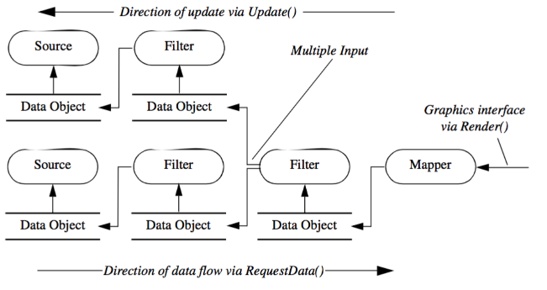
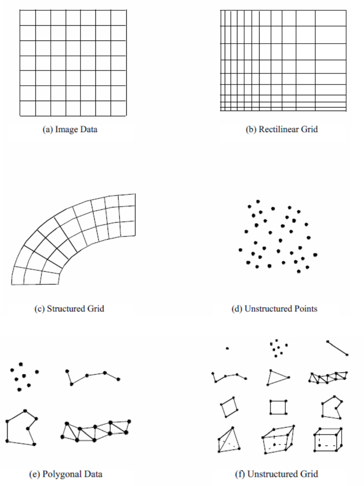
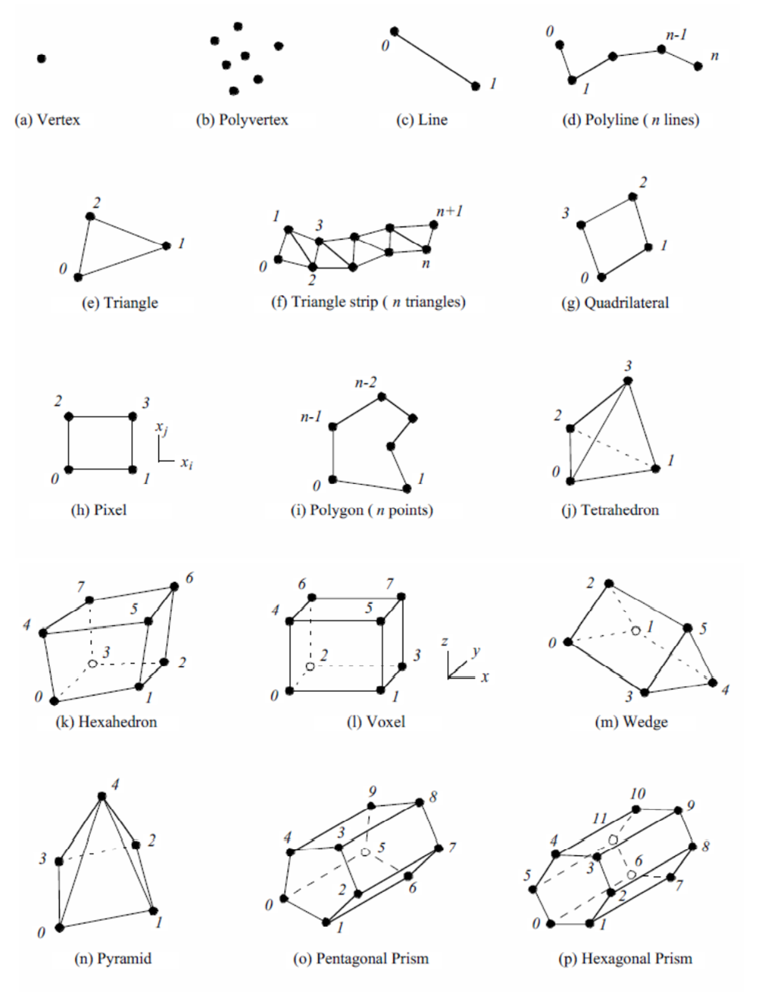
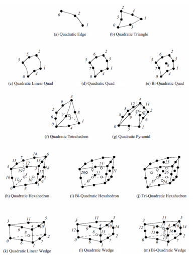
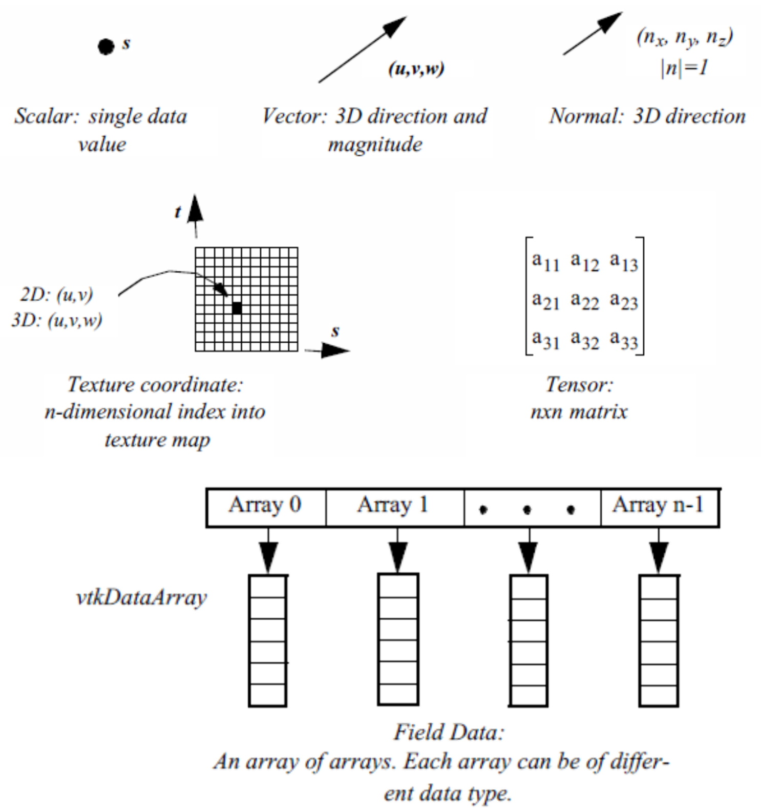

<!-- _class: title -->

# 3D Visualization

## From solver output to a picture someone can act on

Lecture 6 · VTK, meshio, PyVista

<!--
The 3D half of visualization. The 2D half, matplotlib, colour maps and the
checklist for a figure, was part of session 4, and all of it still applies
here. Everything shown here is in the script, so nobody has to copy code from
the screen. What is not in the script is the reasoning, and that is what the
lecture is for.
-->

---

# Today

1. **Three tools**: VTK, meshio and PyVista, and which one to reach for
2. **How VTK thinks**: the pipeline, dataset types and cell types
3. **Formats**: getting a mesh out of the solver and into Python
4. **Live**: from `beam_stress.vtu` to a figure you can defend

<p class="note">Script: Visualization chapter. Data: <code>data/</code> in the course repository.</p>

---

<!-- _class: ask -->

# Your solver produced 1.2 million elements. Now what?

<!--
The bridge into 3D. A common answer is ParaView, and a good one: ParaView is
VTK with a GUI. Here we do the same thing from Python, which is what lets you
automate it.
-->

---

# Three tools, three jobs

<div class="boxes">
<div><b>VTK</b>The engine. C++ with Python bindings, powers ParaView. Maximum control, verbose.</div>
<div><b>meshio</b>The translator. Reads and writes 30+ mesh formats. Geometry only.</div>
<div><b>PyVista</b>The Python face of VTK. Same power, a fraction of the code.</div>
</div>

<p class="note">In practice: meshio for input and output, PyVista for everything else, VTK when PyVista runs out.</p>

---

# The VTK pipeline

<div class="cols">
<div>

```
Source → Filter → Filter → Mapper
  ↓        ↓        ↓         ↓
 Read    Clip    Contour   To
 data    volume  surfaces  graphics
```

Demand driven: nothing is computed until something asks for it. That is what
makes large models workable.

</div>
<div>



</div>
</div>

<!--
The pipeline idea is the transferable part. Anyone who understands it can find
their way around ParaView, and around any postprocessor built on VTK.
-->

---

# Dataset types

<div class="cols">
<div>

- **Unstructured grid**: mixed elements, the FE case
- **Structured grid**: regular topology, CFD
- **Polygonal data**: surfaces, CAD
- **Image data**: voxels, tomography

For FE results you will almost always be holding an unstructured grid.

</div>
<div>



</div>
</div>

---

# Cell types match the FE element library

<div class="cols">
<div>

**Linear**



Tet, hex, wedge, pyramid

</div>
<div>

**Quadratic**



C3D10, C3D20, 15 node wedge

</div>
</div>

<p class="note">The same zoo as in Abaqus or CalculiX, which is why the conversion works at all.</p>

---

# VTK: the cost of control

<div class="cols">
<div>

```python
import vtk

cone = vtk.vtkConeSource()
mapper = vtk.vtkPolyDataMapper()
mapper.SetInputConnection(
    cone.GetOutputPort())
actor = vtk.vtkActor()
actor.SetMapper(mapper)
renderer = vtk.vtkRenderer()
renderer.AddActor(actor)
window = vtk.vtkRenderWindow()
window.AddRenderer(renderer)
window.Render()
```

</div>
<div>

```python
import pyvista as pv

pv.Cone().plot()
```

Same cone.

The VTK version is not wrong, it is explicit. You need that explicitness perhaps
once a semester.

</div>
</div>

---

# The format problem

Every solver speaks its own dialect: `.inp`, `.frd`, `.msh`, `.cdb`, `.exo`, `.vtu`

```python
import meshio

mesh = meshio.read("conrod.inp")     # Abaqus in
meshio.write("conrod.vtu", mesh)     # VTK out
```

```bash
meshio convert conrod.inp conrod.vtu
meshio info conrod.inp
```

> meshio moves geometry and connectivity. Result fields are a different problem,
> and that is why the solver has to export them for you.

---

<!-- _class: live -->

# Convert and inspect

```bash
meshio info data/conrod.inp
meshio convert data/conrod.inp /tmp/conrod.vtu
```

```python
import pyvista as pv
mesh = pv.read("/tmp/conrod.vtu")
print(mesh)                  # points, cells, bounds
print(mesh.array_names)      # which fields came along
mesh.plot(show_edges=True)
```

<!--
meshio info comes first, and its output is worth reading line by line: how
many points, which cell types. Then convert and open it. The empty array_names
list is the important moment: the geometry survived, the results did not.
-->

---

# PyVista in four lines

```python
import pyvista as pv
import numpy as np

mesh = pv.read("data/beam_stress.vtu")
mesh["utilisation"] = mesh["S_MISES"] / 235.0      # fields are numpy arrays
mesh.plot(scalars="utilisation", cmap="viridis", show_edges=True)
```

<p class="note">A field is a numpy array on the mesh. Everything you know about numpy applies.</p>

---

# Scalars, vectors, deformation

<div class="cols">
<div>

```python
# scalar field per point or per cell
mesh["Temperature"] = t_array

# deform by a vector field
warped = mesh.warp_by_vector(
    "U", factor=50)

# cut it open
clipped = mesh.clip("x")

# isosurfaces
iso = mesh.contour(
    scalars="S_MISES",
    isosurfaces=8)
```

</div>
<div>



</div>
</div>

---

<!-- _class: live -->

# The beam, properly

```python
mesh = pv.read("data/beam_stress.vtu")
print(mesh.array_names)

p = pv.Plotter()
p.add_mesh(mesh.warp_by_vector("U", factor=100),
           scalars="S_MISES", cmap="viridis",
           show_edges=True, scalar_bar_args={"title": "von Mises [MPa]"})
p.show()
```

<!--
Try the deformation factor first at 1, where nothing is visible, then at 100.
The factor changes the picture, but what does it do to the truth? Then switch
the colour map to jet once, and the point about colour maps from session 4
becomes visible on a real stress field.
-->

---

# When it gets big

- `mesh.points = mesh.points.astype(np.float32)` halves the memory
- `mesh.decimate(0.9)` for a surface you only need to look at
- `inplace=True` avoids copying the whole mesh
- Filters are lazy: chain them, then render once

<p class="note">A million elements is normal. Rendering one is not the same as processing one.</p>

---

# Where this goes

```python
from pyvistaqt import QtInteractor

class FEMViewer(QtWidgets.QMainWindow):
    def __init__(self):
        super().__init__()
        self.plotter = QtInteractor(self)
        self.setCentralWidget(self.plotter.interactor)
```

The same plotter, embedded in a window with your own controls. That is the Qt
block, and it is where the final assignment usually starts.

---

# Recap

- **meshio** translates, **PyVista** visualizes, **VTK** is underneath both.
- VTK is a **pipeline**: nothing is computed until something asks for it.
- FE results are an **unstructured grid**, with the cell types of your solver.
- A field on a mesh is a **numpy array**. That is the whole trick.
- **Perceptually uniform colour maps**, in 3D as in 2D. Rainbow invents edges.

---

<!-- _class: section -->

# Next

## Mesh visualization workshop

<p>Live coding, then broken code to repair, then a blank page.</p>

<p>Bring the beam, and your own colour map decision.</p>
