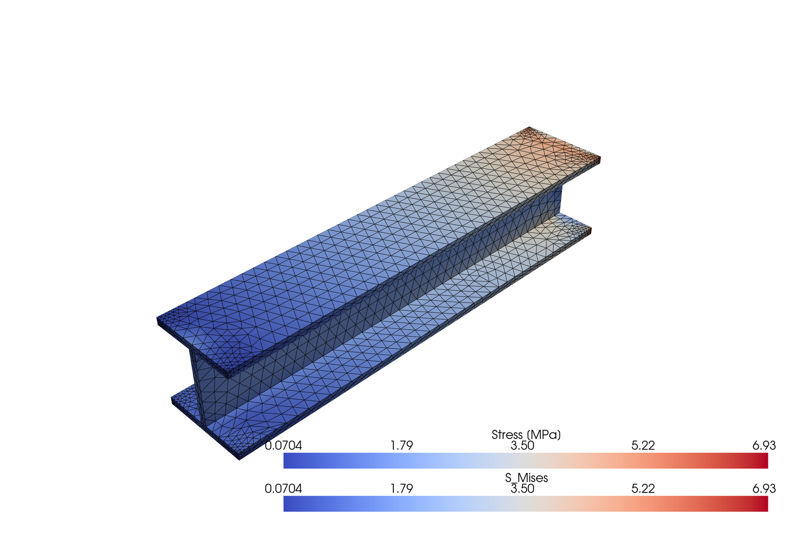
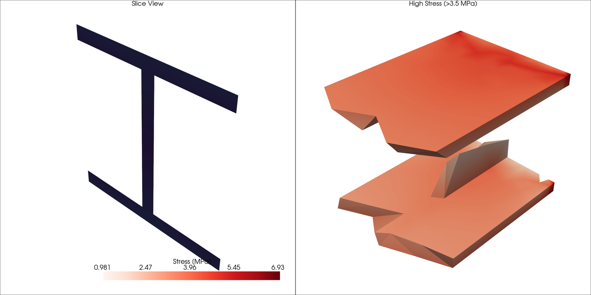

<!-- _class: title -->

# Mesh Visualization Workshop

## Typing it yourself: live, broken, blank

Workshop 7 · PyVista on real FE results

<!--
A workshop, not a lecture. The concepts were in session 6. Today everyone
writes the code themselves, and each of the three blocks takes away a little
more of the help. The full instructions are on the course site under
Visualization, Mesh Visualization Workshop.
-->

---

# Today

<div class="boxes">
<div><b>Block 1 · Live coding</b>I type, you type along. Same code, your fingers.</div>
<div><b>Block 2 · Broken code</b>Three programs that run and are still wrong. You repair them.</div>
<div><b>Block 3 · Blank page</b>A mesh and a target picture. No template.</div>
</div>

<p class="note">No submission today. Keep your scripts anyway: the FEM challenge and the final assignment build on exactly this code.</p>

---

<!-- _class: ask -->

# No copy and paste. Why?

<!--
Typing is slower, and that is the point. Copied code passes through the
clipboard and never through your head. Typed code produces typos, and finding
your own typo is the cheapest debugging practice there is. By block 3 there is
nothing to copy from anyway.
-->

---

<!-- _class: section -->

# Block 1

## Live coding

<p>45 minutes · type along</p>

---

<!-- _class: live -->

# A mesh is geometry plus data

```python
import pyvista as pv
import numpy as np

mesh = pv.read("../visdat-course/data/beam_stress.vtu")
print(mesh)                  # points, cells, bounds, arrays
print(mesh.array_names)      # U, S, S_Mises, E, ...
print(mesh.points.shape)     # (3745, 3): one row per node
print(mesh.n_cells)          # 1723 quadratic tetrahedra

stress = mesh["S_Mises"]     # a plain numpy array
print(stress.min(), stress.max(), stress.mean())
```

<!--
Start with pv.Report() if anyone's installation is in doubt. Points are the
coordinates, cells say which points belong together, arrays carry the data. The
last line is the bridge back to session 4: once the field is a numpy array,
everything from data processing applies.
-->

---

# The window

<div class="cols">
<div>

**Mouse**

- Left drag: rotate
- Right drag: zoom
- Middle drag: pan

**Keys**

- `r` reset camera, `w` wireframe, `s` surface
- `q` close the window

</div>
<div>

**Two ways to plot**

```python
mesh.plot()            # one line

pl = pv.Plotter()      # full control
pl.add_mesh(mesh)
pl.show()
```

Both **block**: the script waits until the window is closed.

</div>
</div>

<!--
Show the blocking with a print after show(). It surprises people the first
time, and it is the reason the Qt block later needs pyvistaqt.
-->

---

<!-- _class: live -->

# Build the picture step by step

```python
limit = 0.8 * stress.max()
critical = mesh.threshold(value=limit, scalars="S_Mises")

pl = pv.Plotter()
pl.add_mesh(mesh, opacity=0.3, color="lightgrey")
pl.add_mesh(critical, scalars="S_Mises", cmap="viridis",
            scalar_bar_args={"title": "von Mises [MPa]"})
pl.camera_position = "iso"
pl.show()
```

<p class="note">One step at a time, and run it after every step. Then try <code>slice()</code> and <code>clip()</code>.</p>

<!--
Build it in this order: plain mesh, colour, scalar bar, camera, then the
threshold and the transparent base mesh. Ask where the highest stress sits and
whether that matches what an engineer would expect for this beam. The limit is
relative on purpose: the beam only reaches about 7 MPa, and a fixed value like
100 would return an empty mesh.
-->

---

<!-- _class: live -->

# Two views, side by side

```python
pl = pv.Plotter(shape=(1, 2))

pl.subplot(0, 0)
pl.add_text("Full beam", font_size=10)
pl.add_mesh(mesh, scalars="S_Mises", cmap="viridis",
            show_edges=True, edge_color="black")

pl.subplot(0, 1)
pl.add_text("Above 80 % of the maximum", font_size=10)
pl.add_mesh(critical, scalars="S_Mises", cmap="viridis")

pl.link_views()
pl.show(screenshot="beam_stress.png")
```

<!--
Once it works, swap viridis for jet in one panel. The point from sessions 4
and 6 shows up again: jet draws bands into the beam that are not in the data.
show(screenshot=...) saves the picture as the window closes, which is how a
figure ends up in a report without anyone pressing a key.
-->

---

<!-- _class: section -->

# Block 2

## Broken code

<p>45 minutes · three programs, all of them run</p>

---

# The code runs. It is still wrong.

<div class="cols">
<div>

1. Read the whole program before you run it
2. Say what it **should** do
3. Print the values in between
4. Try the edges: min, max, empty, boundary
5. Fix **one** bug, run again

</div>
<div>

| Exercise | Time | Start with |
|---|---|---|
| Stress analyzer | 15 min | Does the safety factor make engineering sense? |
| Mesh comparison | 12 min | Does the difference panel make sense? |
| Stress report | 18 min | Do the zones add up to 100 %? |

</div>
</div>

<p class="note">No syntax errors anywhere. Python is happy. The engineer should not be.</p>

<!--
This is the kind of bug that matters in practice: no traceback, a plausible
picture, a wrong number. Resist walking around and pointing at the bug. Ask the
question in the right column instead.
-->

---

<!-- _class: ask -->

# What did the bug look like from the outside?

<!--
Five minutes at the end of the block. Collect two or three answers. The useful
lesson is not the fix but the symptom: a safety factor that is too good, a
difference that is zero everywhere, percentages that do not add up. Those are
the signals to look for in your own results.
-->

---

<!-- _class: section -->

# Block 3

## Blank page

<p>45 minutes · a mesh, a target, no template</p>

---

# Challenges 1 and 2

<div class="cols">
<div>

**1 · Basic**



`S_Mises`, colour bar with title, edges in black

</div>
<div>

**2 · Advanced**



Slice, threshold, two colour maps side by side

</div>
</div>

<p class="note">Stuck? <code>print(mesh)</code>, <code>mesh.array_names</code>, docs.pyvista.org, then your neighbour.</p>

---

# Challenge 3: your choice

<div class="boxes">
<div><b>A · Warp</b>Original and deformed side by side. Choose the scale factor and say which one.</div>
<div><b>B · Clip</b>Cut the beam open and show the inside.</div>
<div><b>C · Several meshes</b>The beam and the connecting rod in one scene, or a mesh of your own.</div>
</div>

<p class="note">For C: read <code>conrod.inp</code> with meshio and convert it. <code>pv.read()</code> takes <code>.inp</code> for a different format and returns a mesh without cells.</p>

---

<!-- _class: ask -->

# Which colour map did you choose, and why?

<!--
This was the homework from session 6. A good question to end on: challenge 1
asks for coolwarm, a diverging map with a neutral centre. von Mises stress is
never negative, so what does the white middle of that map mean on this beam?
Nothing, which is the point. A diverging map belongs to data with a meaningful
zero in the middle, such as a signed principal stress.
-->

---

# Recap

- A mesh is **points, cells and arrays**, and an array is numpy
- `plot()` and `show()` **block** until the window is closed
- Build a figure **one step at a time** and run it after each step
- The worst bugs **run without an error**. Check the numbers against what you expect.
- A colour map is a **decision** about the data, not a default

---

<!-- _class: section -->

# Next

## FEM coding challenge

<p>Write the solver behind numbers like these, in pairs.</p>

<p>Course site → Visualization → FEM Coding Challenge</p>
