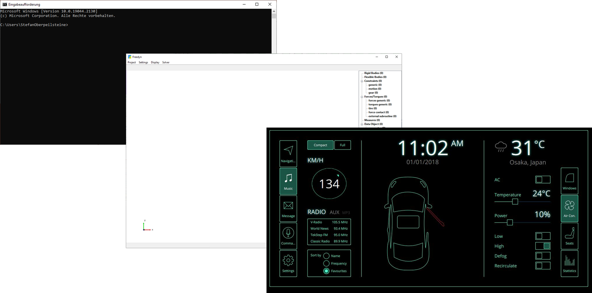
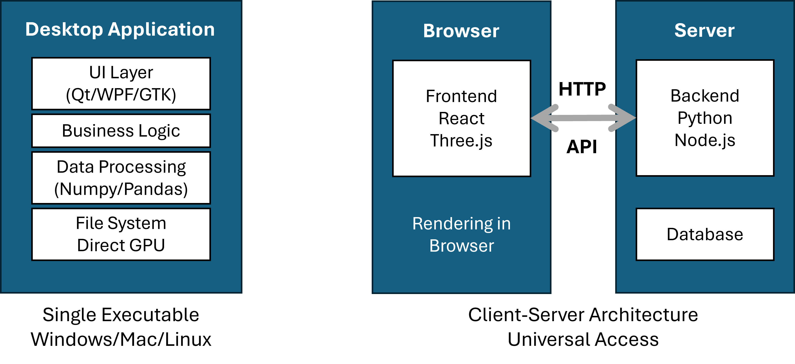
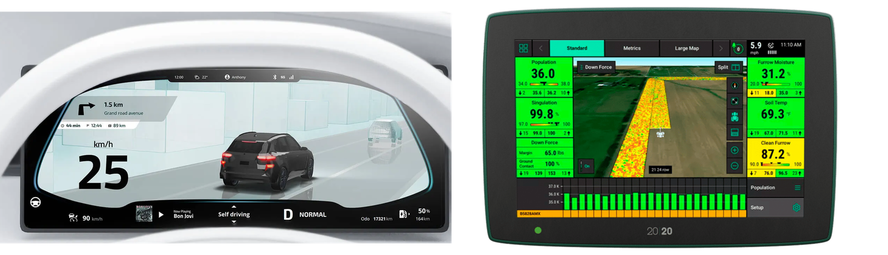

<!-- _class: title -->

# User Interfaces

## Turning your script into a tool somebody else can use

Lecture 7 · Qt, PyQt6, PyVista

<!--
Three blocks. The first is short on purpose: the interesting part is blocks two
and three, where a small application grows step by step on the screen. The Qt
workshop picks up exactly where block three stops. Before it come the mesh
workshop and the FEM challenge, so by the time you build the viewer, PyVista is
something you can write without looking it up.
-->

---

# Today

1. **Why an interface at all**, and desktop against web
2. **PyQt6**: windows, layouts, signals and slots, the event loop
3. **PyVista in Qt**: the 3D view inside your own window

And along the way, the Python from session 3 again: references, scope, classes,
functions as objects.

<p class="note">After this: the mesh workshop and the FEM challenge, then the Qt workshop, where you build an FEM viewer.</p>

---

<!-- _class: ask -->

# Your viewer script works perfectly. Your colleague still cannot use it. Why?

<!--
Typical answers: the colleague has no Python, does not know which file to
edit, does not know what to change, or broke it. All correct. A user interface is not
decoration, it is the difference between a script and a tool.
-->

---

# What an interface actually buys

<div class="boxes">
<div><b>Reach</b>People who know the domain but not the language can use your work.</div>
<div><b>Speed</b>Change a parameter and see the result, instead of editing and rerunning.</div>
<div><b>Safety</b>The interface only offers what is valid, so fewer wrong inputs reach the code.</div>
</div>

<p class="note">The first internal tool you write at a company is usually a small window around a script that already worked.</p>

---

# Where this comes from



From batch jobs on a mainframe, through the desktop era and native CAD, to the
browser. Engineering software sat on the desktop the whole time, for one reason:
performance on large models.

---

# Desktop and web are different architectures



<p class="note">Desktop: one process, direct access to the GPU. Web: a browser, a server, and a connection in between.</p>

---

# Which one, when

<div class="cols">
<div>

**Desktop**

Millions of cells, maximum rendering performance, offline, access to CAD files
and hardware.

ParaView, MATLAB, every CAD system.

</div>
<div>

**Web**

Many occasional users, sharing and review, no installation, central deployment.

Dash, Streamlit, result viewers for a team.

</div>
</div>

> In practice both: the desktop tool for the person doing the work, a web view
> for everyone who only needs to look.

---

<!-- _class: section -->

# PyQt6

## The framework behind most engineering software you know

---

# You have used Qt all day without noticing



ParaView, Maya, VLC, Audacity, the dashboard in a car, the terminal on an
agricultural machine. Qt has been in production for over thirty years, it is
genuinely cross platform, and it talks to OpenGL directly.

---

# PyQt6 or PySide6

<div class="cols">
<div>

**PyQt6**

GPL or commercial licence. What we use here.

</div>
<div>

**PySide6**

The Qt Company's own bindings, LGPL.

</div>
</div>

The APIs are close to identical. Code written against one usually runs against
the other after changing the import.

<p class="note">Both PyQt6 and pyvistaqt are in <code>requirements.txt</code>. PyVista already opens its windows through Qt, so you have been using it since the visualization block.</p>

---

# One file, six steps

From an empty window to a 3D view with a slider beside it.

Every step is the complete file, with the new lines highlighted:
**Script → User Interfaces → Live Coding**

Copy, paste, run. Then we look at what changed, and break it on purpose.

<!--
Nobody has to type along. The code is on the script page, and every step there
is complete, so if you fall behind you copy the next step and are back on track.
Watch what happens on the screen, and above all, answer the questions before
the code runs.
-->

---

<!-- _class: live -->

# Step 1: the smallest application that works

```python
from PyQt6.QtWidgets import QApplication, QWidget

app = QApplication([])          # 1. the application object

window = QWidget()              # 2. a window
window.setWindowTitle("First Qt App")
window.resize(400, 300)

window.show()                   # 3. show it
app.exec()                      # 4. hand control to the event loop
```

<!--
Worth trying: run it, then delete app.exec() and run again. The window flashes
and disappears. The script reaches its end, Python exits, and the window goes
with it. That single experiment explains the event loop better than a
paragraph, and it comes back in step 4.
-->

---

# Layouts, not coordinates

```python
layout = QVBoxLayout()
layout.addWidget(QLabel("Enter your name:"))
layout.addWidget(QLineEdit())
layout.addWidget(QPushButton("Greet"))
window.setLayout(layout)
```

`QVBoxLayout`, `QHBoxLayout`, `QGridLayout`, `QFormLayout`

> Never position a widget by pixel. A layout survives a resize, a different
> font size, a different operating system and a different screen. Fixed
> coordinates survive none of those.

---

# Signals and slots

```python
button = QPushButton("Load mesh")
button.clicked.connect(self.open_file)      # signal → slot

slider.valueChanged.connect(self.update_scale)
combo.currentTextChanged.connect(self.set_field)
```

<div class="boxes">
<div><b>Signal</b>Something happened. The widget announces it and does not care who listens.</div>
<div><b>Slot</b>A function that reacts. It does not care who called it.</div>
<div><b>Connection</b>Made at runtime, can be undone, can be many to many.</div>
</div>

<p class="note">This is what keeps the interface and the computation separable, and therefore testable.</p>

---

<!-- _class: live -->

# Step 2: a layout and a signal

```python
def greet():
    label.setText(f"Hello, {name_input.text()}!")

...
label = QLabel("Enter your name:")
name_input = QLineEdit()
button = QPushButton("Greet")
button.clicked.connect(greet)
```

`greet` uses `label` before the line that creates it. Why does that work?

<!--
Python looks up a name when the function runs, not when it is defined. By the
time anybody clicks, label and name_input exist at module level. This is the
scope rule from session 3: inside the function, Python finds no local name
label, so it looks in the module.
-->

---

# Predict the output

<div class="timer">
<input type="checkbox" id="timer-ui-1">
<label for="timer-ui-1"><span class="tape tens"><b>6</b><b>5</b><b>4</b><b>3</b><b>2</b><b>1</b><b>0</b></span><span class="tape ones"><b>0</b><b>9</b><b>8</b><b>7</b><b>6</b><b>5</b><b>4</b><b>3</b><b>2</b><b>1</b><b>0</b></span></label>
<div class="bar"></div><span class="hint">start / reset</span>
</div>

```python
button.clicked.connect(greet())
```

Two characters more than in step 2. What happens when you click the button?

<!--
You never get to click. The program stops on this line with a TypeError,
"argument 1 has unexpected type 'NoneType'".

greet() calls the function immediately, once, and connect receives what it
returns, which is None. connect(greet) hands over the function itself, so that
Qt can call it later. In Python a function is an object like a list or a
number, and passing it around without calling it is completely normal.
-->

---

<!-- _class: live -->

# Step 3: the same application as a class

```python
class Greeter(QWidget):
    def __init__(self):
        super().__init__()
        self.label = QLabel("Enter your name:")
        self.name_input = QLineEdit()
        button = QPushButton("Greet")
        button.clicked.connect(self.greet)
        ...

    def greet(self):
        self.label.setText(f"Hello, {self.name_input.text()}!")
```

<!--
Same widgets as in step 2, now kept together in one object. Greeter inherits
from QWidget, so a Greeter is a widget with everything a widget can do.

Worth trying: delete super().__init__(). PyQt stops with "super-class __init__()
of type Greeter was never called". The constructor of QWidget is what creates
the window on the Qt side, and without it there is nothing to set a title on.

self.label is an attribute because greet needs it later. button is only used in
__init__, so a local name is enough. And self.greet is a bound method: the
function together with the object it belongs to, which is why greet has a self.
-->

---

# Predict the output

<div class="timer">
<input type="checkbox" id="timer-ui-2">
<label for="timer-ui-2"><span class="tape tens"><b>6</b><b>5</b><b>4</b><b>3</b><b>2</b><b>1</b><b>0</b></span><span class="tape ones"><b>0</b><b>9</b><b>8</b><b>7</b><b>6</b><b>5</b><b>4</b><b>3</b><b>2</b><b>1</b><b>0</b></span></label>
<div class="bar"></div><span class="hint">start / reset</span>
</div>

```python
def open_window():
    window = Greeter()
    window.show()

app = QApplication([])
open_window()
app.exec()
```

<!--
No window appears, and the program keeps running. When open_window returns,
the local name window is gone, nothing else refers to the object, and Python
deletes it, together with the window on the screen. The event loop then waits
for a window that no longer exists. The bin icon in the VS Code terminal stops
it.

This is the label picture from session 3: an object lives as long as some name
or some other object refers to it. That is why the window in the main block is
kept in a variable, and why everything a class needs later is stored on self.
-->

---

# Parent and child

But `button` in step 3 is also only a local name, and it survives. Why?

```python
layout.addWidget(button)      # the layout gives the button a parent
```

Every widget can have a parent, and the parent keeps its children alive.
Deleting the parent deletes its children. The tree of widgets is also the tree
that manages the memory.

<p class="note">A window has no parent, so all it has are your Python references. That is the whole difference.</p>

---

<!-- _class: live -->

# Step 4a: slow work in the slot

```python
def slow_pi(n):
    total = 0.0
    for i in range(1, n):
        total += 1.0 / (i * i)
    return math.sqrt(6 * total)      # 1/1² + 1/2² + ... = π²/6

def compute(self):
    self.label.setText("Computing...")
    result = slow_pi(50_000_000)
    self.label.setText(f"pi ≈ {result:.8f}")
```

Click Compute, then try to move the window.

<!--
The window does not move, and the label never shows "Computing...". It keeps
its old text and jumps straight to the result. Fifty million terms of the series
take a few seconds, and during those seconds the program does nothing else.

This is the problem, not the solution. The next slide explains why it happens,
and step 4b shows where slow work belongs.
-->

---

# The event loop

```python
app.exec()          # from here on, Qt waits for events
print("closed")     # runs only after the last window closes
```

1. Wait for an event: click, key, timer, signal
2. Send it to the connected slot
3. Repaint what changed
4. Repeat

> Your code runs **inside** this loop. While your function is busy, nothing is
> repainted. So a slot must return quickly, and the slow work happens elsewhere.

<!--
setText only notes that the label has to be repainted. The repainting is done
by the event loop in step 3 of this list, and the event loop is waiting for
compute to return. The same happens when a slot loads a 200 MB mesh.
-->

---

<!-- _class: live -->

# Step 4b: the work in its own thread

```python
class Worker(QObject):
    finished = pyqtSignal(float)            # a signal of our own
    def run(self):
        self.finished.emit(slow_pi(50_000_000))

def compute(self):
    self.label.setText("Computing...")
    self.worker_thread = QThread()
    self.worker = Worker()
    self.worker.moveToThread(self.worker_thread)
    self.worker_thread.started.connect(self.worker.run)
    self.worker.finished.connect(self.show_result)
    self.worker_thread.start()
```

<!--
compute now only starts the work and returns at once. The label shows
"Computing...", the window can be moved, and the result arrives as a signal.
The complete step on the script page also disables the button while the worker
runs and stops the thread when it is done.

The worker is not faster than before. Python runs only one thread at a time
(the GIL) and switches between them every few milliseconds. That is enough to
keep the window responsive. Using several cores at once is the topic of the
session on parallelization.
-->

---

<!-- _class: ask -->

# The worker could set the label itself. Why does it send a signal instead?

<!--
Widgets belong to the main thread and may only be changed there. A signal sent
from the worker thread to an object in the main thread is delivered through the
main thread's event loop, so show_result runs in the right thread, at a moment
when the event loop is free. Signals and slots are not only a way to connect a
button to a function, they are also how threads talk to each other safely.

And why self.worker_thread instead of a local name? With a local name, the
thread object is deleted when compute returns, while the thread still runs, and
the program ends abruptly. The lifetime rule from step 3, with a harder
consequence.
-->

---

# QMainWindow gives you the frame

```python
class MainWindow(QMainWindow):
    def __init__(self):
        super().__init__()
        self.setWindowTitle("FEM Viewer")

        central = QWidget()                 # the central widget is mandatory
        self.setCentralWidget(central)

        file_menu = self.menuBar().addMenu("&File")
        open_action = QAction("&Open...", self)
        open_action.triggered.connect(self.open_mesh)
        file_menu.addAction(open_action)
```

Menu bar, tool bar, status bar and dock widgets come with it.

<!--
The menu is not part of today's steps. The first block of the Qt workshop
builds exactly this menu, with a file dialog behind it.
-->

---

<!-- _class: section -->

# PyVista inside Qt

## The 3D view in your own window

---

<!-- _class: live -->

# Step 5: QtInteractor

```python
from pyvistaqt import QtInteractor

class SphereViewer(QMainWindow):
    def __init__(self):
        super().__init__()
        central = QWidget()
        self.setCentralWidget(central)
        main_layout = QHBoxLayout(central)

        self.plotter = QtInteractor(central)     # a PyVista plotter as a widget
        main_layout.addWidget(self.plotter.interactor)

        self.plotter.add_mesh(pv.Sphere(), color="lightblue", show_edges=True)
```

<!--
The plotter you already know from the visualization block, this time as a
widget you can place anywhere in a layout. QMainWindow needs a central widget,
and the layout goes onto that widget, not onto the window itself.
-->

---

# Controls beside the view

```python
controls = QGroupBox("Controls")            # left: the panel
controls_layout = QVBoxLayout(controls)
slider = QSlider(Qt.Orientation.Horizontal)
slider.setRange(5, 100)
slider.valueChanged.connect(self.update_mesh)
controls_layout.addWidget(slider)

main_layout.addWidget(controls)
main_layout.addWidget(self.plotter.interactor, stretch=3)   # right: the 3D view
```

<p class="note"><code>stretch</code> decides who gets the space when the window grows. <code>Qt.Orientation.Horizontal</code> is an enumeration: a name instead of a magic number.</p>

---

<!-- _class: live -->

# Step 6: make the slider do something

```python
def update_mesh(self, value):
    self.resolution_label.setText(f"Resolution: {value}")
    sphere = pv.Sphere(theta_resolution=value, phi_resolution=value)
    self.plotter.clear()
    self.plotter.add_mesh(sphere, color="lightblue", show_edges=True)
    self.plotter.reset_camera()
```

Drag the slider and watch the sphere change. Then drag it fast.

<!--
update_mesh is an ordinary method. Qt calls it on every slider movement, and
the last line of __init__ calls it once directly, so that the sphere is there
before anybody touches the slider. A slot is not a special kind of function.

Dragging fast shows the flicker and the cost of clear() plus add_mesh() on every
event. That sets up the slide after next.
-->

---

# Always clean up

```python
def closeEvent(self, event):
    self.plotter.close()
    event.accept()
```

Nobody in our code calls `closeEvent`. `QMainWindow` already has a method of
that name, and Qt calls it when the window closes. Defining our own
**overrides** it, so Qt now calls our version.

<p class="note">VTK holds resources that Qt knows nothing about. Releasing them here keeps the exit clean.</p>

---

# Updating geometry without the flicker

<div class="cols">
<div>

**Rebuild**

```python
self.plotter.clear()
self.plotter.add_mesh(...)
```

New field, new mesh, new scalar bar.

</div>
<div>

**Move the points**

```python
self.mesh.points = new_points
self.plotter.render()
```

Same mesh, different shape. Animations.

</div>
</div>

<p class="note">The second keeps the scalar bar and the camera, so nothing jumps while an animation runs.</p>

---

# Recap

- An interface makes a script into something **another person** can operate
- **Layouts**, never coordinates
- **Signals and slots** keep interface and computation apart, and a slot is
  just a function, passed **without** parentheses
- An object lives as long as something **refers** to it: a name, `self`, or a
  parent widget
- Your code runs **inside the event loop**: slow work goes into a
  `QThread` and comes back as a signal
- **QtInteractor** puts the PyVista view into your own window, and
  `closeEvent` cleans it up

---

<!-- _class: section -->

# Next

## Mesh workshop and FEM challenge

<p>Two workshops in 3D: PyVista until it is routine, then a solver of your own.</p>

<p>After that, the Qt workshop: an FEM viewer with file dialog, field selection, deformation and screenshot export.</p>
